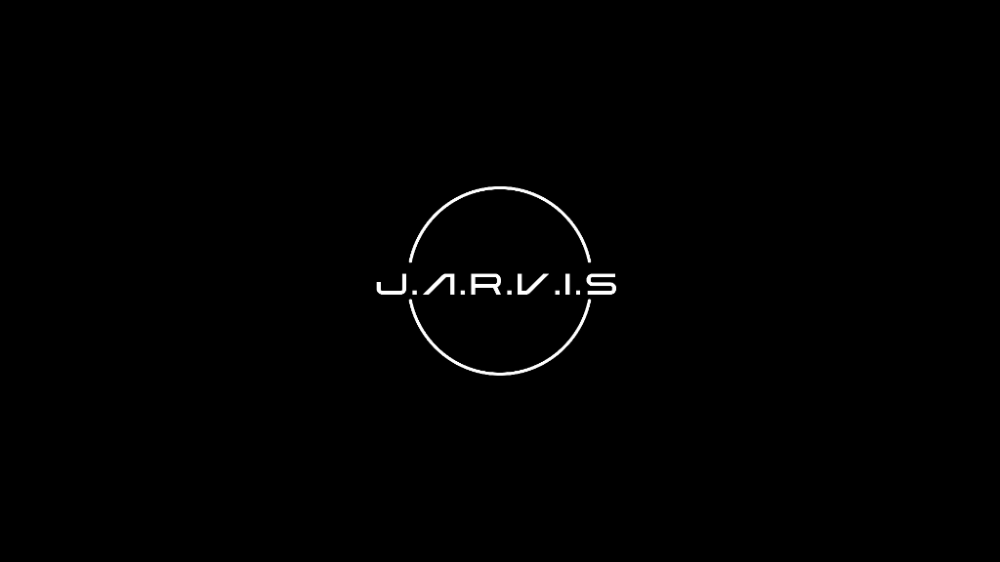

# jarvis

<p align="center">
  
</p>

**J.A.R.V.I.S** is a high-frame-rate (60 FPS) native Windows desktop screen companion built with **PySide6 (Qt 6)**. It lives discreetly in your top hardware notch and system tray, sees your active screen context on demand, draws crisp explanations directly over live apps, reads answers aloud with **AssemblyAI** voices, and can scroll or trigger desktop/browser actions while explaining long pages.

## Highlights

- **Native Launcher (`Jarvis.exe`)**: Standalone Windows executable with the custom `J.A.R.V.I.S` icon (provided in both repo root `Jarvis.exe` and `windows/Jarvis.exe`).
- **60 FPS Top Hardware Notch**: Translucent floating notch strip (`Idle` 64x10 pill, `Listening`, `Thinking`, `Speaking`, inline quick text input, bottom captions with Stop button, and Home Peek carousel).
- **Precision Screen Ink Overlay**: Click-through 2x Retina DPI overlay featuring a clean blue directional pointer, smooth Catmull-Rom ink strokes, sequential `precise_lines` text underlines synchronized with subtle pen foley, translucent paper diagram cards, and karaoke underlines.
- **Lasso & Draw-to-Ask**: Drag a smooth freehand neon lasso over any region of your screen (`Ctrl + Shift + D`) so Jarvis zooms into that crop and explains what you highlighted.
- **Scroll-and-Explain Mode**: Designed for reading long answers and docs (including ChatGPT threads): Jarvis automatically scrolls step-by-step and annotates each section visually.
- **Desktop & Browser Actions**: Built-in agent helpers to open URLs/apps, trigger hotkeys, scroll pages smoothly, or perform contextual GUI steps.
- **Real-Time Voice Pipeline**:
  - **Speech-to-Text**: AssemblyAI v3 streaming (`u3-rt-pro`) via WebSocket with push-to-talk (`Ctrl + Space` / `Ctrl + Alt`).
  - **Vision Reasoning**: SSE streaming chat with live screen capture.
  - **Voice Synthesis (TTS)**: AssemblyAI `AssemblyAI-TTS-1` 24 kHz neural voices with offline Windows SAPI fallback.

## Project Structure

- `Jarvis.exe` / `windows/Jarvis.exe`: Compiled `.NET` Windows launcher (`windows/JarvisLauncher.cs`).
- `windows/jarvis.py`: Entry point, Qt setup, CLI `--selftest`, `--snapshot`, and `--demo` modes.
- `windows/jarvis_app.py`: Main application controller coordinating windows, tray icon, voice pipeline, SSE vision, TTS, scrolling, and agent actions.
- `windows/jarvis_notch_window.py`: 60 FPS top notch window and Home Peek overlay.
- `windows/jarvis_overlay_windows.py`: Click-through screen ink overlay, lasso capture, paper cards, and Clear button.
- `windows/jarvis_main_window.py`: Chat, Sessions, Skills, Studio & Keys, and full Personal Settings window.
- `windows/jarvis_services.py`: AssemblyAI STT/TTS clients, River AI vision SSE client, mic stream, screen capture, foley audio, and desktop agent service.
- `windows/jarvis_response_parser.py`: Structured drawing command parser, prompt builder, and sentence chunker.
- `windows/jarvis_config.py` & `windows/jarvis_theme.py`: `.env` loader, `user_settings.json` persistence, 60 FPS spring physics, fonts, and palette tokens.

## Setup & Running

1. **Install Python dependencies** (Python 3.11+ recommended):
   ```powershell
   pip install PySide6 sounddevice numpy websocket-client requests pillow mss pygame python-dotenv pywin32
   ```

2. **Configure API keys**:
   Copy `.env.example` to `.env` in the repo root (or `windows/.env`) and add your personal keys:
   ```env
   RIVER_AI_API=your_river_ai_api_key_here
   ASSEMBLYAI_API_KEY=your_assemblyai_api_key_here
   ```
   > `.env` and `user_settings.json` are excluded via `.gitignore` so personal API keys are never pushed to Git.

3. **Run Jarvis**:
   Double-click `Jarvis.exe` (or run from PowerShell):
   ```powershell
   .\Jarvis.exe
   # Or run directly via Python:
   python .\windows\jarvis.py
   ```

4. **Built-in diagnostics**:
   ```powershell
   .\Jarvis.exe --selftest
   .\Jarvis.exe --demo --demo-seconds 3
   ```

## Inspiration

We took architectural and visual inspiration from an open desktop screen-companion project for the floating notch ergonomics, cursor pointing flow, and voice-first screen interaction model, and re-engineered it natively for Windows on PySide6 with custom branding, high-DPI overlay ink, AssemblyAI voice synthesis, and personal API key support.
